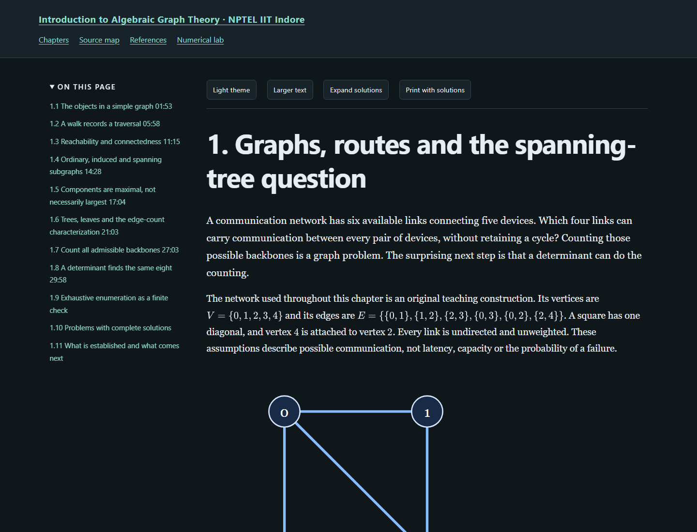

# Introduction to Algebraic Graph Theory — independent study notes

[Read the textbook](https://az9713.github.io/nptel-algebraic-graph-theory-notes/)

[](https://az9713.github.io/nptel-algebraic-graph-theory-notes/)

An original, substantial rewrite of Prof. Ranveer Singh’s NPTEL course at **IIT Indore**. The supplied NPTEL-NOC IITM playlist supplies the chronological source spine; IIT Madras hosts/co-ordinates the channel rather than being the instructor’s affiliation.

The edition contains 16 chapters, 139 complete worked solutions, 16 executed mathematical programs and an interactive graph laboratory. Its approximately 61,000 whitespace tokens include mathematics and code. Coverage runs from incidence matrices and spanning trees through spectral bounds, mixing, cospectrality, sensitivity, expanders, Fiedler vectors and signed graphs.

All 45 playlist identities were acquired and their full machine transcripts read sequentially. Entries 41 and 45 are byte-identical acquired audio and share one transcript, leaving 44 unique audio representations. Machine ASR and chunk boundaries remain fallible; no comprehensive audiovisual or board-equation audit is claimed. Original teaching constructions, lecture material and bounded primary-reference claims are distinguished beside the relevant arguments.

Each exact chapter body received two independent AI scientific reviews, including proofs, solutions, computation and selected primary sources. Review is evidence with a stated scope, not formal proof verification or a guarantee of correctness. See the [completion record](completion.json), [course review](course-review.json), [editorial record](editorial-review-summary.json), [full source map](source-map.html) and [workflow](WORKFLOW.md).

Open index.html locally for the offline dark reader, bundled MathJax, search, source navigation, theme and text controls, solutions, printing and code copying. There are no remote fonts, analytics or runtime network dependencies. External recording/reference links require network access.

## Rebuild and verify

Run every command from this project directory. A project-local virtual environment can install the Python requirements:

```powershell
python -m venv .venv
.venv/Scripts/python -m pip install -r requirements.txt
.venv/Scripts/python tools/build_book.py
.venv/Scripts/python tools/check_chapter_code.py
.venv/Scripts/python numerical_lab.py
.venv/Scripts/python tools/validate_books.py
.venv/Scripts/python tools/audit_public.py --release
```

For browser checks, install Chromium inside the project and then run the hidden checks:

```powershell
$env:PLAYWRIGHT_BROWSERS_PATH = "$PWD/work/browsers"
.venv/Scripts/python -m playwright install chromium
.venv/Scripts/python tools/validate_books.py --browser
.venv/Scripts/python tools/verify_source_free.py --git --browser
```

The source-free test exports committed HEAD and rebuilds/tests the public package without private audio, ASR, downloaded papers, prompts or review reports. It uses installed Python dependencies and Chromium; it is not a pristine-machine installation test. tools/update_metadata.py is a private-evidence reconciliation tool and intentionally requires acquisition evidence under ignored work/. Public rebuilds use the published provenance sidecars directly.

Validation records describe static checks, all-program execution, 40 offline page/viewport checks, exact HTML regeneration, source-free Git export and served publication bytes. The publication report excludes its own hash, with served JSON separately checked, to avoid an impossible self-hash assertion. Publication state and material limits are recorded in completion.json.
